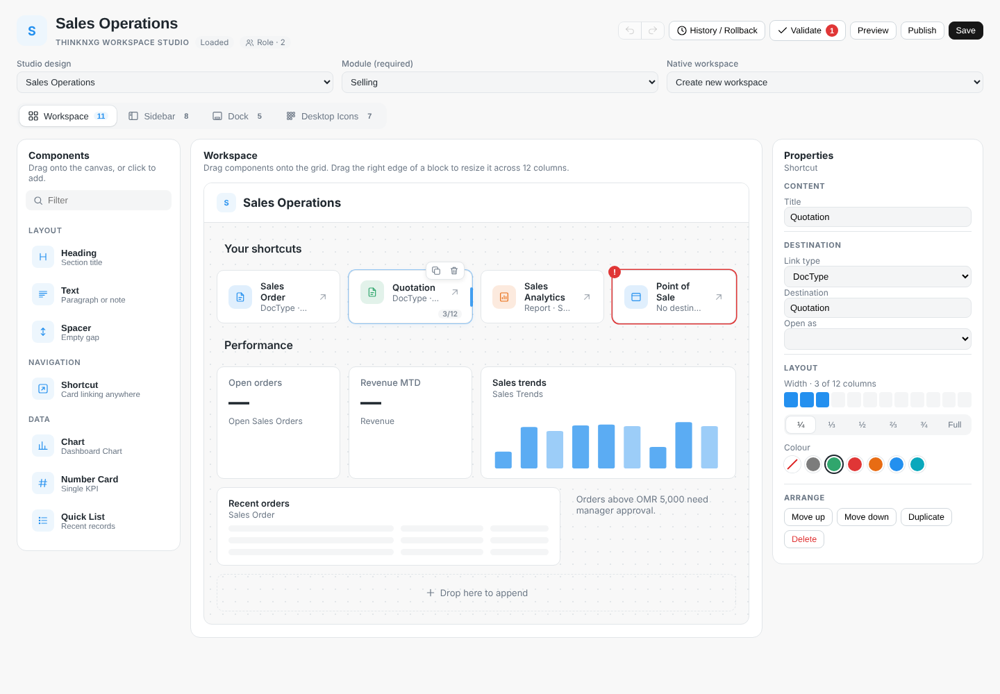
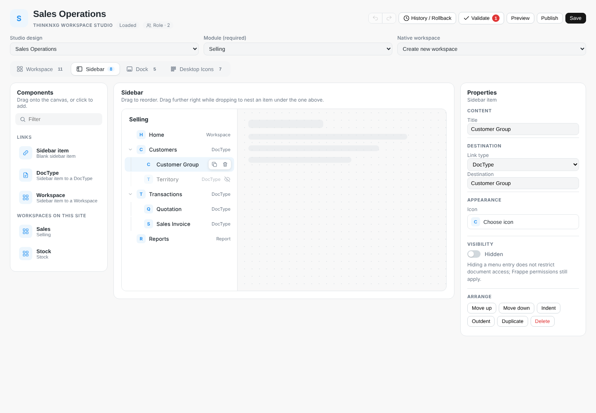
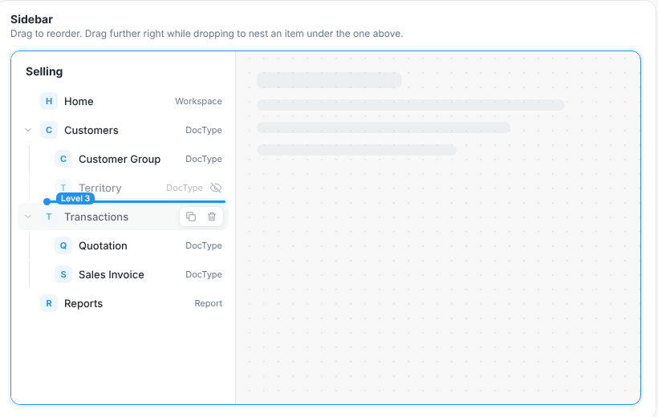
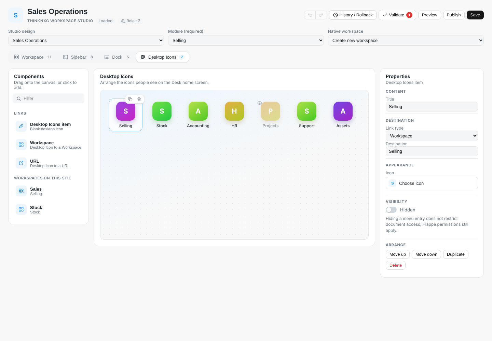
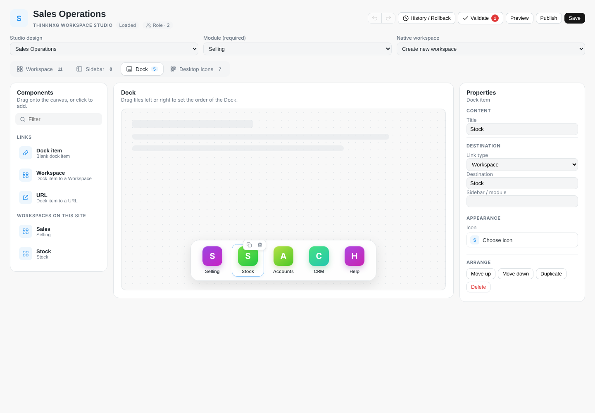
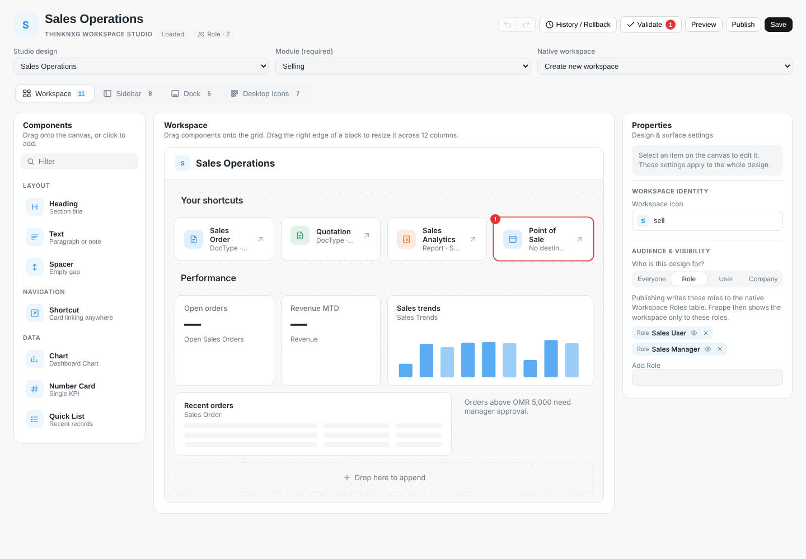

# thinkNXG Workspace Studio

Visual administrator workspace design and guarded native publishing for **Frappe / ERPNext v16**.

## Install

```bash
cd ~/frappe-bench
bench get-app https://github.com/thinknxg/Workspace-Studio.git
bench --site your-site install-app thinknxg_workspace_studio
bench --site your-site migrate
bench build --app thinknxg_workspace_studio
bench --site your-site clear-cache
bench restart
```

Open `/app/workspace-studio`.

## Native publishing

Studio manages native Workspace blocks (content + reference tables), Sidebar/Workspace Sidebar, Dock, and Desktop Icon documents. Each native document is backed up before publishing; rollback is available via `thinknxg_workspace_studio.api.rollback`. Only supported Frappe fields are written; unknown component schemas are rejected.

Publishing must be enabled explicitly via **Studio Settings → Enable Guarded Publishing**, after testing on a staging site. The implementation is schema-aware but has **not** been tested on your actual v16 installation. Do not enable publishing in production without validation.

## Known limitations

- Desktop Icon removal from a design does not delete an existing native icon. Desktop order is retained in Studio; native position is not mapped.
- Sidebar nesting controls require an installed Int indent/level field. Check-based child/group schemas remain flat in this editor.
- Preview displays layout and reference placeholders, not live chart data or an embedded native Desk.
- Role audiences are enforced through the native Workspace Roles table. User/department/company audiences are stored, but native runtime personalisation is not yet wired into Desk.
- Shortcut colour and "Open as" are written only when the installed Workspace Shortcut has those fields; otherwise they stay in the Studio design.
- Built-in authorization remains governed by Frappe; hiding a menu does not restrict document access.
- Existing Sidebar/Dock structures vary by v16 release. Publishing fails if required native fields are absent.

## Visual designer

Open Workspace Studio as a **System Manager** or **Workspace Studio Manager** (`/app/workspace-studio`, or **Open in Workspace Studio** on any Studio Workspace record). Layout, Sidebar, Dock and Desktop Icon data are edited only through canvases and property panels — the stored JSON fields are hidden on the form.



**Top bar.** Type the workspace title in place. Undo/Redo (Ctrl+Z / Ctrl+Shift+Z), History / Rollback, Validate (with a live issue count), Preview, Publish and Save. Choose the Studio design, Module and target native Workspace below it.

**Four canvases** that look like the Desk surface they publish to, each with a live item count:

| Surface | Canvas | Direct manipulation |
|---|---|---|
| Workspace | Page header + 12-column grid with shortcut cards, chart, number card, quick list, heading, text and spacer blocks | Drag to reorder (insertion line shows the spot), drag a block's right edge to resize in column steps, double-click a title to rename |
| Sidebar | Desk sidebar beside a ghosted page | Drag to reorder; while dropping, move the pointer right to nest under the row above or left to outdent (indicator shows the level). Subtrees move together; parents collapse |
| Dock | Floating dock bar | Drag tiles left/right |
| Desktop Icons | Home-screen icon grid | Drag icons within the grid |

 
 

**Components panel.** Searchable tiles grouped as Layout, Navigation and Data on the Workspace surface. On Sidebar, Dock and Desktop it offers a blank item, one tile per link type the installed schema supports, and **Workspaces on this site** — drop one to create a ready-linked entry. Click any tile to append instead of dragging.

**Properties panel.** Grouped sections instead of raw fields:
- *Content* — title, heading level (H1–H6), text.
- *Destination / Data source* — link type, Link-picker destination (URL validation for external links), Dashboard Chart / Number Card / DocType pickers, "Open as" view where the schema offers one, Dock sidebar/module.
- *Layout* — 12-cell width bar plus ¼ ⅓ ½ ⅔ ¾ Full presets; shortcut colour swatches read from the installed Workspace Shortcut colours.
- *Appearance* — icon picker built from the icon sprite loaded in Desk (searchable, accepts a typed name).
- *Visibility* — Hidden switch for Sidebar and Desktop items (dimmed on canvas, removed in preview).
- *Arrange* — Move up/down, Indent/Outdent (numeric-nesting schemas only), Duplicate, Delete.

Hover a block for Duplicate/Delete; with a block focused, Delete removes it, Ctrl+D duplicates, Alt+↑/↓ moves it and Esc clears the selection. Blocks with problems get a red marker whose tooltip explains what is missing, and each Validate message has a **Show** link that jumps to the item.

**Design settings** appear when nothing is selected: *Publish this surface* (off = leave native data alone; on with no items = publish an empty list), Sidebar title or Dock application, the workspace icon, and **Audience & visibility**:
- **Everyone** (Global) leaves existing native role restrictions untouched.
- **Role** — add roles with a Link picker; they are saved as Studio Assignment records and, on publish, written to the native Workspace **Roles** table so Frappe itself hides the workspace from everyone else. Publishing a Role-scoped design with no enabled role is refused.
- **User / Department / Company** — saved as Studio Assignments for future runtime personalisation; Desk does not enforce them yet, and the panel says so.



**Preview** hides all editing affordances and renders the current surface at Desktop, Tablet (780 px) or Mobile (390 px) width. Charts and numbers are placeholders. **Save** stores a draft; **Publish** asks for a note, saves the visible design first and calls the guarded native publisher. **History / Rollback** lists versions and restores published native backups.

### Saved-format compatibility

Run `bench migrate` after updating so the Studio Workspace form hides its JSON fields and picks up the form button; no data migration is required. Storage remains `layout_json.components`, `navigation_json.items`, `dock_json.entries`, and `dock_json.desktop_icons`. Additional root, component and config keys survive loading and saving. Existing scope is retained. Optional missing sections stay absent until enabled. Incomplete legacy drafts can still be saved by the API; strict publication validation rejects invalid destinations, unsupported types, missing references, invalid nesting/widths and duplicate shortcut/icon labels.

Native publish/rollback endpoints, backups, settings and manager roles are retained. Small metadata-aware adapters map URL shortcuts, modern Sidebar row/link types, and Quick List DocType references without changing saved Studio keys. On layered Dock schemas, Studio selects the site layer (nonstandard, no user), not a personal/app layer. Schemas with absent required fields continue to fail and roll back. Native Select validation and document validation remain Frappe's responsibility; the local preview does not certify schema compatibility.

## Development validation

Run from the repository root:

```sh
node --test tests/designer_model.test.cjs
python -B -m unittest discover -s tests -p 'test_*.py'
node tests/browser_smoke.cjs
node tests/browser_visual.cjs
```

Browser tests: install `playwright` and `jquery@3.7.1` in your development environment, install a Playwright Chromium browser, then run `node tests/browser_smoke.cjs`. Optional `PLAYWRIGHT_MODULE`, `JQUERY_PATH` and `CHROME_PATH` environment variables select preinstalled tooling. The test uses a **mocked Frappe API/control layer** and real headless Chromium to exercise four surfaces, pickers, actual drag/drop, preview, save/reload, preserved scope, validation, and save-before-publish. `browser_visual.cjs` drives the visual interactions: edge resizing, undo/redo, inline titles, block tools, keyboard delete, Sidebar nesting by pointer travel with the live indicator, library drops onto Desktop and Dock, the icon picker, Hidden, Role audience save/reload and preview widths. The drop, resize, nesting, duplicate and history rules are pure functions in `designer_model.js` with their own node tests. Python tests use Frappe doubles for manager checks, settings gates, validation-before-write, native reference mapping and publish savepoint rollback. These do not replace a live Bench integration test.

### Required staging checks

- Build assets, reload Desk, and open both an existing saved design and a new design on your installed Frappe/ERPNext v16 patch.
- Confirm actual Link picker search results and permissions for DocTypes, Pages, Reports, Dashboard Charts, Number Cards and the installed navigation link types.
- Publish all enabled surfaces into disposable native targets with a note. Compare native content/reference rows and verify native Desk rendering.
- Verify supported Sidebar nesting, Dock site-layer selection, and Desktop Icon behavior for that patch. Deprecated/read-only native DocTypes may be rejected by Frappe.
- Confirm non-manager denial, disabled-publish settings, native before/after snapshots, successful rollback, and refusal to roll back after a manual native edit.
- Inject an incompatible schema mapping and verify no partial native changes commit.

No server deployment or production certification is included.

### Module selection and editor layout

Choose an existing **Module** before Save or Publish. Missing or deleted modules are rejected before writes with an actionable message. When older API callers omit the module on an existing design, its saved module is retained. A removed module stays visible in the selector for correction rather than silently clearing. No Studio DocType schema change is required.

The page explicitly loads its designer stylesheet as well as its state model. At desktop widths Components, Canvas and Properties appear side by side; medium widths move Properties below, and narrow screens stack the panels. If an older cached page still appears unstyled after updating the code, rebuild the app assets, clear the site cache and hard-refresh Desk.

### Native publishing on current v16 — integration investigation

Current v16 protects app-owned Sidebar documents outside developer mode. Workspace Studio uses the site-wide **Custom Sidebar** layer when available, retaining the older Sidebar mapping for earlier schemas. Published rows are marked as additions, and the native permission resolver remains authoritative.

On the legacy Desktop Icon grid, destinations are real **Workspace** documents. Studio sets the native icon type and validates the Workspace before adapting the archived Dynamic Link declaration used by v16. The site must already use **Desktop Settings → Desktop Icons**; Apps mode is rejected with an actionable message. Studio does not silently switch the global desktop mode.

The draft integration workflow creates a disposable ERPNext 16.51.0 / Frappe 16.52.0 site with real MariaDB and Redis, installs the app, and checks native documents, resolved Sidebar items, Desktop Icon payload visibility and rollback. See the workflow results for evidence; neither local mocks nor a sample front-end preview establish live publishing correctness.
